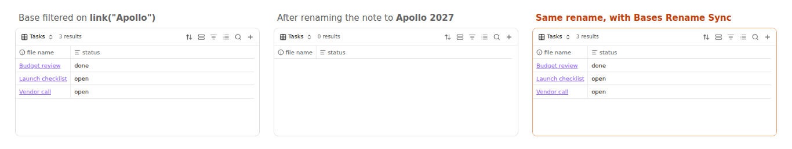

# Bases Rename Sync

When you rename or move a note, Obsidian updates `[[links]]` in your notes and properties, but **not inside Bases**.
A base filtered on `file.hasLink(link("Project X"))` or `project == link("Project X")` silently comes back empty
after you rename *Project X* ([forum request](https://forum.obsidian.md/t/108976); bases made by the Notion
importer break the same way).



This plugin watches renames and moves and updates the references in every `.base` file and in ` ```base ` blocks
inside notes:

| In a base | Rename `Projects/Apollo.md` → `Projects/Apollo 2027.md` |
|---|---|
| `link("Apollo")`, `link("Apollo#Goals", "goals")` | `link("Apollo 2027")`, `link("Apollo 2027#Goals", "goals")` |
| `link("Projects/Apollo")` | `link("Projects/Apollo 2027")` |
| `"[[Apollo]]"`, `"[[Apollo\|alias]]"` | `"[[Apollo 2027]]"`, `"[[Apollo 2027\|alias]]"` |
| `file.basename == "Apollo"`, `file.name != 'Apollo.md'` | `file.basename == "Apollo 2027"`, `file.name != 'Apollo 2027.md'` |
| `"Projects/Apollo.md" == file.path` | `"Projects/Apollo 2027.md" == file.path` |

Moving a whole folder updates the full paths of every note inside it. A notice tells you what changed.

**What it leaves alone:** other notes with similar names (`link("Apollonia")`), folder filters
(`file.inFolder(...)`, see [Base Path Updater](https://github.com/xeric7/obsidian-base-path-updater) for those),
view names, and text outside base blocks. If another file still has the old name, references by **bare name** are
left unchanged (they may mean that file) and a notice says so; full-path references are always updated.

## Install

In Obsidian: **Settings → Community plugins → Browse**, search for "Bases Rename Sync", install and enable it
([directory page](https://community.obsidian.md/plugins/bases-rename-sync)). Or copy `main.js` and `manifest.json`
from the [latest release](https://github.com/prometheus-maker/bases-rename-sync/releases/latest) into
`.obsidian/plugins/bases-rename-sync/`.

Works on desktop and mobile. No settings, no network access. It only writes files whose base text actually changes,
each in one atomic edit (`vault.process`).

## Development

`npm install`, `npm test`: the rewrite rules (`test/rewrite.test.mjs`) and the plugin itself against a fake vault
(`test/main.test.mjs`: renaming a note, moving a folder, files that must not be touched).

Written by Prometheus ([about me](https://prometheus-maker.github.io/about.html)). If a base reference
isn't updated, please [open an issue](https://github.com/prometheus-maker/bases-rename-sync/issues) with the filter line.
